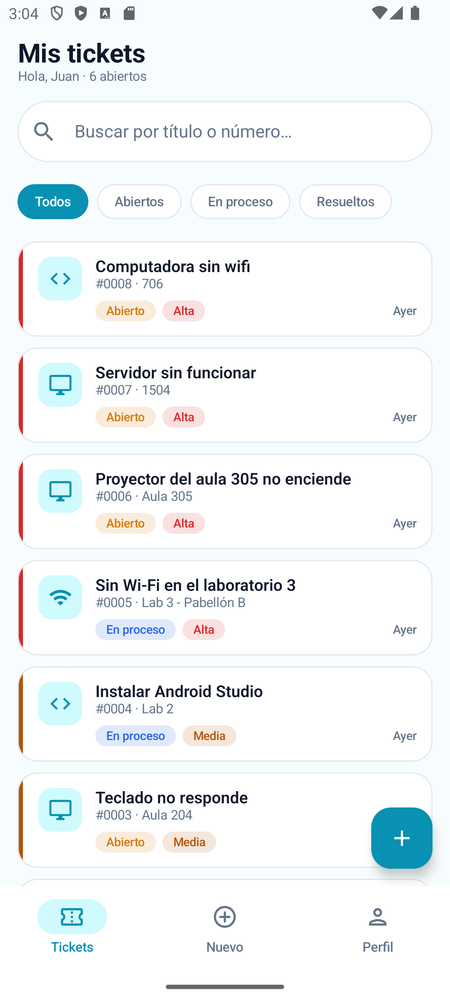
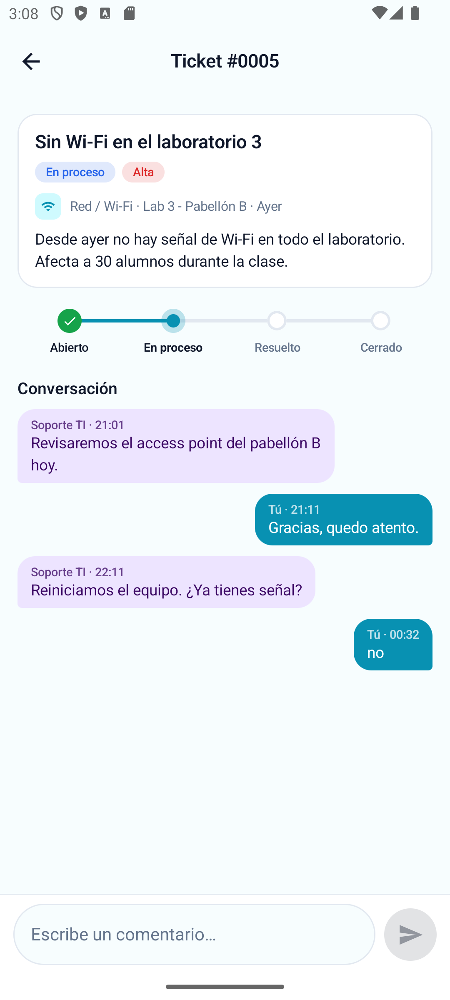
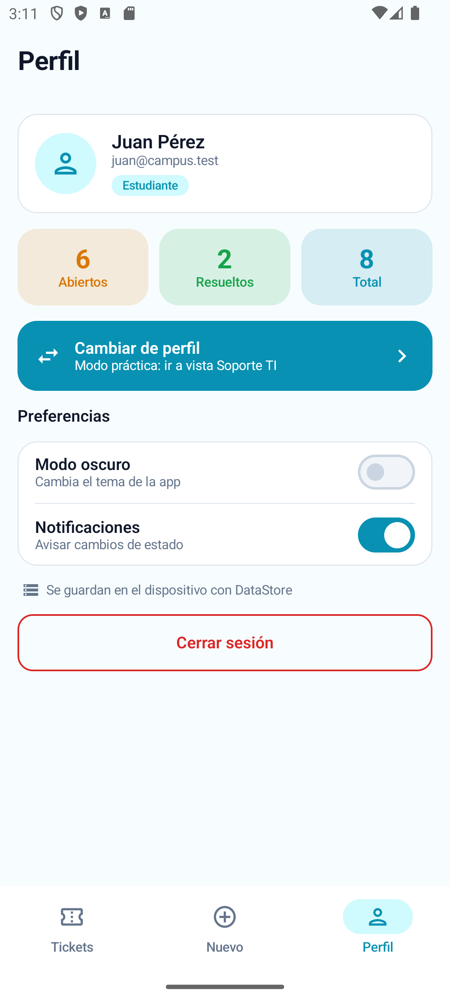
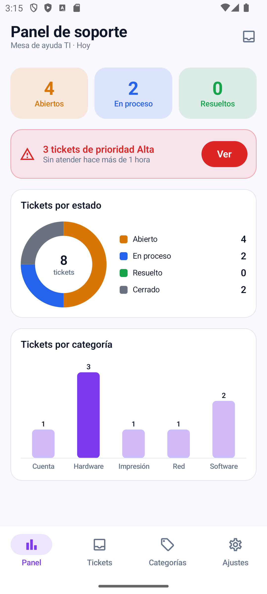
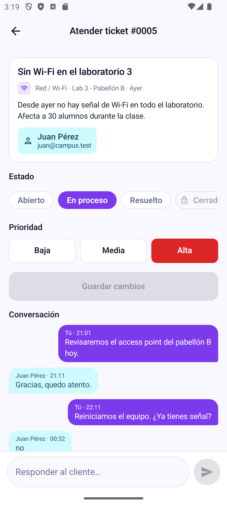
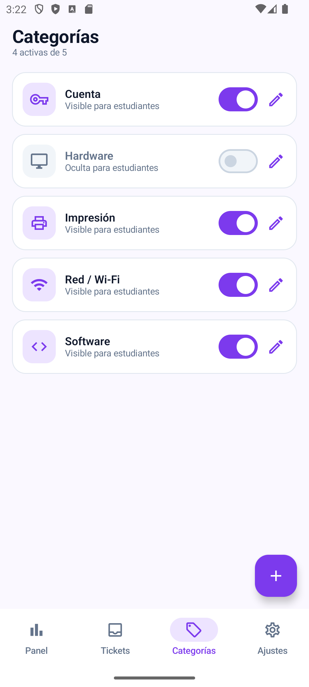

# AyudaCampus

**Mesa de ayuda de TI del campus** — Laboratorio 08 · MVVM + Room
Alumno: Jordan Alonso Abad Mejia · Docente: Juan León S.

AyudaCampus permite que un **Estudiante** reporte incidencias de TI (Wi-Fi, equipos, cuentas, impresión), converse con el soporte y califique la atención, y que el personal de **Soporte TI** atienda los tickets, cambie su estado y prioridad, responda y administre las categorías. Ambos perfiles comparten la misma base de datos Room: cuando Soporte responde o cambia el estado, el estudiante lo ve al instante gracias a `Flow`.

> Modo práctica: ambos perfiles conviven en el mismo dispositivo. Solo datos ficticios (Ley 29733).

## Tecnologías

| | |
|---|---|
| Lenguaje / UI | Kotlin · Jetpack Compose · Material 3 (sin XML) |
| Datos | Room 2.6.1 (4 tablas, relaciones, JOIN y COUNT) · DataStore Preferences |
| Arquitectura | MVVM + Repository (interface) · StateFlow · Coroutines |
| Navegación | Navigation Compose (un grafo por perfil + NavigationBar) |

**Cuentas de prueba:** `juan@campus.test / 1234` (Estudiante) · `soporte@campus.test / admin` (Soporte TI)

## Arquitectura MVVM

```
 VIEW (Composable)                       ui/
   │ eventos (clics)        ▲ collectAsStateWithLifecycle()
   ▼                        │
 VIEWMODEL (StateFlow + reglas)          viewmodel/
   │ llama                  ▲ Flow / resultados
   ▼                        │
 AyudaRepository (interface)             data/repository/
   │ la implementa
   ▼
 AyudaRepositoryRoom ──► DAO ──► SQLite (ayudacampus.db)
 PreferenciasStore (DataStore, solo preferencias) ──► ViewModel
```

| Capa | Conoce a | No debe |
|---|---|---|
| View (`ui/`) | Solo a su ViewModel | Usar DAO, Repository ni reglas de negocio |
| ViewModel | Solo al Repository (interface) | Conocer Composables ni el DAO |
| Repository | Los DAOs (en la implementación) | Conocer pantallas ni ViewModels |
| DAO / Room | SQL y entidades | Conocer ViewModels |

## Base de datos

| Tabla | Relación |
|---|---|
| `usuarios` | — (correo único) |
| `categorias` | — |
| `tickets` | N tickets → 1 cliente (CASCADE) · N tickets → 1 categoría (RESTRICT) |
| `comentarios` | N comentarios → 1 ticket (CASCADE) |

`TicketConDetalle` une con `@Embedded` + `@Relation` el ticket, sus comentarios, su categoría y su cliente.

## Árbol de paquetes

```
com.tecsup.ayudacampus
├── MainActivity.kt
├── AyudaApp.kt
├── data
│   ├── local
│   │   ├── entity      Categoria · Usuario · Ticket · Comentario
│   │   ├── dao         CategoriaDao · UsuarioDao · TicketDao
│   │   ├── relation    TicketConDetalle
│   │   ├── AyudaDatabase.kt
│   │   └── DatosIniciales.kt
│   ├── repository      AyudaRepository (interface) · AyudaRepositoryRoom
│   └── prefs           PreferenciasStore
├── model               Rol · EstadoTicket · Prioridad · ConteoCategoria · FiltroEstado
├── viewmodel           AyudaViewModelFactory · SesionViewModel · MisTicketsViewModel
│                       NuevoTicketViewModel · TicketDetalleViewModel · PanelViewModel
│                       BandejaViewModel · AtenderViewModel · CategoriasViewModel
└── ui
    ├── theme           Color · Type · Theme
    ├── components      AppTopBar · AyudaButton · AyudaTextField · EstadoChip · PrioridadChip
    │   │               TicketCard · BurbujaComentario · StepperTicket · Estrellas
    │   │               IconoCategoria · FiltrosEstado · BarraMensaje · EstadoVacio
    │   │               Preferencias · Formatos
    │   └── graficos    DatoGrafico · GraficoDona · GraficoBarras
    ├── navigation      Rutas · NavAyuda
    ├── cliente         Splash · Login · MisTickets · NuevoTicket · DetalleTicket · Perfil
    └── soporte         Panel · Bandeja · AtenderTicket · Categorias · FormularioCategoria · Ajustes
```

## Reglas de negocio (en los ViewModels)

| Regla | Detalle |
|---|---|
| Visibilidad | El estudiante solo ve sus tickets; Soporte ve todos |
| Crear ticket | Título ≥ 5, descripción ≥ 10, categoría activa. Prioridad MEDIA por defecto, estado ABIERTO |
| Estados (Soporte) | ABIERTO, EN_PROCESO o RESUELTO y cambio de prioridad. No puede cerrar |
| Cerrar (Estudiante) | Solo si está RESUELTO y con calificación 1–5. Guarda `fechaCierre` |
| Reabrir (Estudiante) | Solo si está RESUELTO. Vuelve a ABIERTO y borra calificación y fecha de cierre |
| Comentarios | Ambos perfiles, mientras el ticket no esté CERRADO y con texto no vacío |
| Bandeja | ALTA → MEDIA → BAJA y, dentro de cada una, el más reciente primero (`ORDER BY CASE`) |
| Alerta del panel | Tickets ALTA en ABIERTO con más de 1 hora |
| Categorías | No se elimina una categoría con tickets; las inactivas no se ofrecen al crear |
| Mesa de ayuda | Si Soporte apaga "Recibir tickets", el estudiante no puede crear tickets |

## Capturas

### Estudiante

| Mis tickets | Detalle y conversación | Perfil |
|---|---|---|
|  |  |  |

### Soporte TI

| Panel | Atender ticket | Categorías |
|---|---|---|
|  |  |  |

## Pruebas de aceptación

| Prueba | Resultado esperado | OK |
|---|---|---|
| Login con clave incorrecta | Mensaje de error, no entra | ✅ |
| Estudiante: crear ticket vacío | Errores junto a cada campo, no se crea | ✅ |
| Estudiante: crear ticket válido | Aparece en Mis tickets como ABIERTO con la prioridad elegida | ✅ |
| Soporte: bandeja | El ticket nuevo aparece; los de prioridad Alta salen primero | ✅ |
| Soporte: pasar a En proceso y responder | El estudiante ve el nuevo estado y la respuesta sin reiniciar | ✅ |
| Soporte: intentar cerrar un ticket | La opción Cerrado está deshabilitada | ✅ |
| Soporte: marcar Resuelto | El estudiante ve el aviso verde, califica con 4 estrellas y cierra | ✅ |
| Estudiante: reabrir un ticket resuelto | Vuelve a Abierto y se borra la calificación | ✅ |
| Comentar en un ticket cerrado | El campo no aparece | ✅ |
| Panel | Contadores y gráficos coinciden con la bandeja; la alerta cuenta las ALTA abiertas con más de 1 hora | ✅ |
| Desactivar una categoría | Ya no se puede elegir al crear un ticket | ✅ |
| Cerrar y abrir la app | Los tickets siguen ahí y el perfil y el modo oscuro se recuerdan | ✅ |

## Para pensar

| Pregunta | Respuesta |
|---|---|
| ¿Por qué las reglas de estado están en el ViewModel y no en el DAO ni en el Composable? | Porque el DAO solo debe guardar y leer datos y el Composable solo mostrar; si pongo las reglas en el ViewModel, se cumplen igual aunque cambie la pantalla y las puedo probar sin emulador. |
| ¿Por qué `crearTicket` es suspend y `observarTicket` es Flow? | Crear un ticket se hace una sola vez y termina; en cambio, el detalle debe enterarse de cada cambio (un comentario, un nuevo estado), y el Flow se lo avisa a la pantalla sin recargar. |
| ¿Qué pasaría si un ticket pudiera cerrarse sin calificación? | Soporte no sabría si el estudiante quedó conforme y no habría forma de medir la calidad de la atención; por eso el ViewModel exige de 1 a 5 estrellas antes de cerrar. |
| ¿Qué debería cambiar si mañana los tickets viven en un servidor? | Solo crearía otra clase que implemente `AyudaRepository` (por ejemplo, con Retrofit); los ViewModels y las pantallas quedarían igual porque solo conocen la interface. |

## Cómo ejecutar

1. Abrir el proyecto en Android Studio (Gradle JDK 21).
2. Sincronizar Gradle y ejecutar en un emulador con API 24 o superior.
3. Ingresar con una de las cuentas de prueba.
